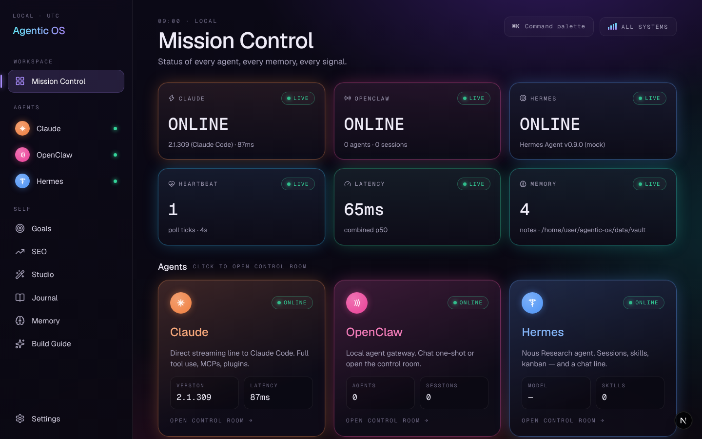
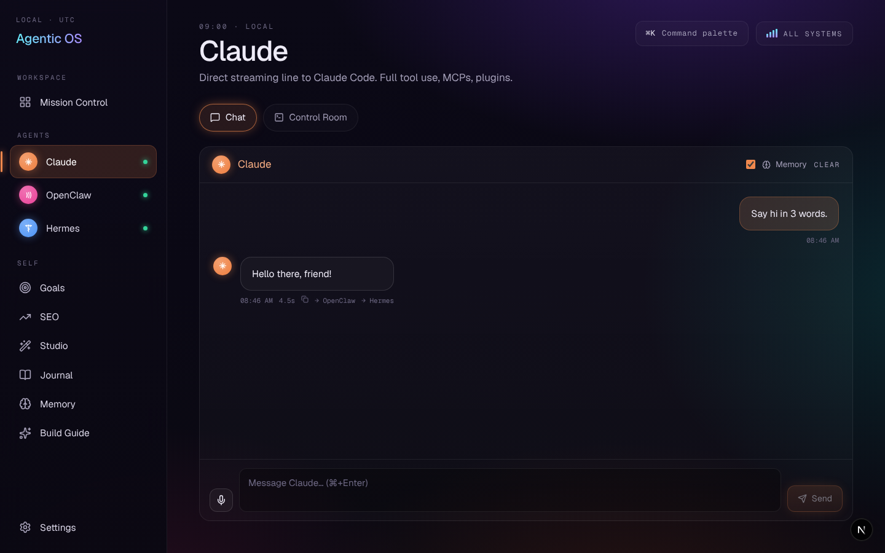
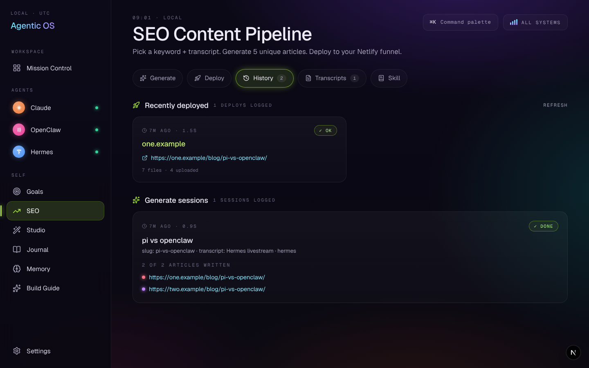
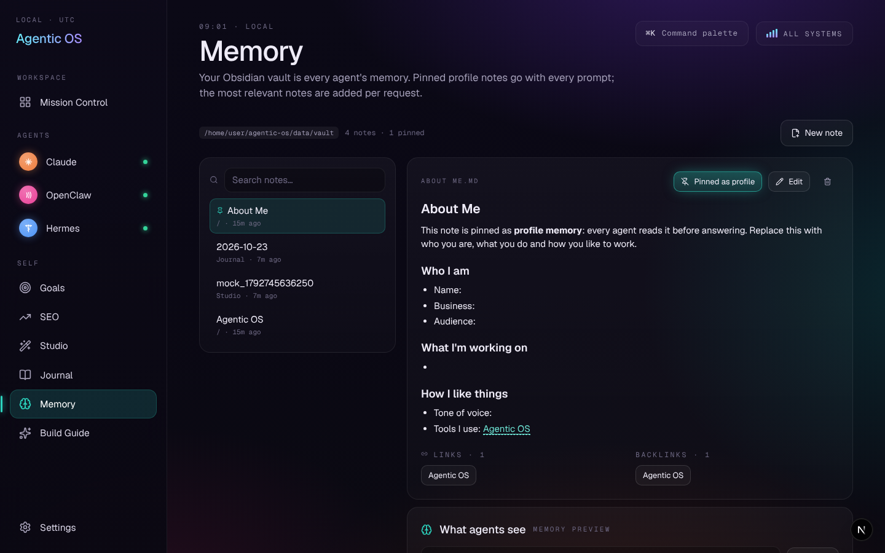
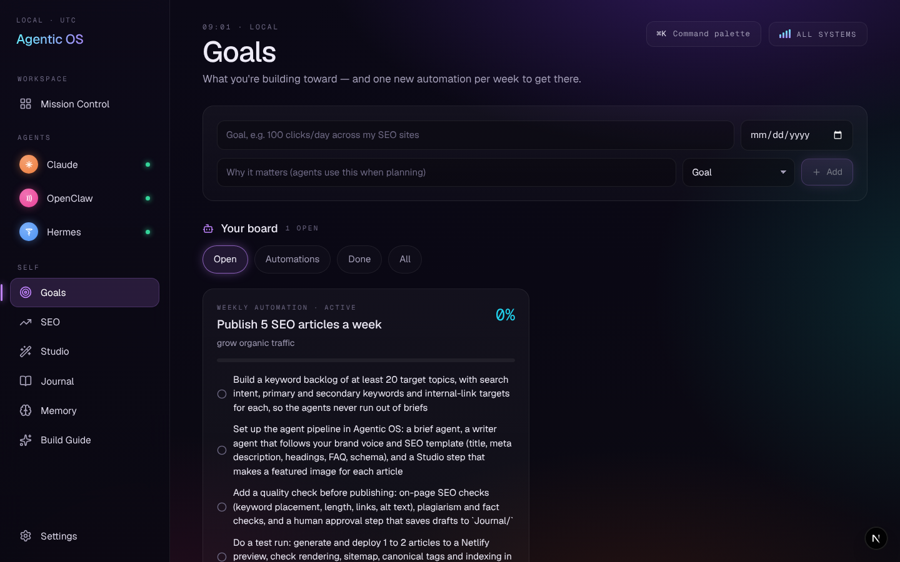

# Agentic OS

A local-first operating system for your AI agents. One dashboard on `http://localhost:3737` that talks to
**Claude Code**, **Hermes** (Nous Research) and **OpenClaw**, runs an **SEO content pipeline** that deploys
to Netlify, generates media in a **Studio**, and gives every agent a shared **memory**: your Obsidian vault.
That memory is what lets each agent know who you are.



| | |
|---|---|
|  |  |
|  |  |

## What's inside

| Screen | What it does |
|---|---|
| **Mission Control** | Live status for every agent: version, model, latency, a heartbeat that polls every 4s, combined p50 latency, memory size, recent signals and active goals |
| **Claude** | Token-streaming chat with Claude Code (`claude -p --output-format stream-json`). Each chat resumes its session. A Control Room tab adds a console, a kanban and raw status |
| **OpenClaw** | Chat through the CLI or the gateway's HTTP endpoint. Shows agent and session counts, plus its own Control Room |
| **Hermes** | Chat through the CLI or its OpenAI-compatible API. Shows model and provider, installed skills and sessions, plus a kanban |
| **Boardroom** | Ask Claude, Hermes, OpenClaw and the API fallback the same question at once. Their answers stream side by side, then one agent chairs the board and writes a recommendation |
| **Goals** | Goals with milestones, and **scheduled automations** (hourly, daily or weekly) that run an agent in the background. **Plan with agent** splits a goal into steps, using your memory |
| **SEO** | Keyword + transcript → one unique article per site → preview → deploy to Netlify. Tabs: Generate · Deploy · History (with **Google Search Console clicks** per site) · Transcripts · Skill (an editable `SKILL.md`) |
| **Studio** | Images, videos and speech made by your agent or an OpenAI-compatible API. Voice input, inline preview, download, save to vault |
| **Journal** | One note per day in `Journal/YYYY-MM-DD.md` inside your vault, quick log lines, a timeline of what your agents did, and an agent-written reflection |
| **Memory** | Browse, search and edit your vault, with wikilinks and backlinks. Pin "profile" notes, preview the exact context agents receive, and **import your OMI conversations** as daily notes |
| **Build Guide / Settings** | Setup steps inside the app, and settings for every agent, Netlify site and provider |

Also included: a **⌘K command palette** ("Ask Hermes: …" jumps straight into a chat), an **ALL SYSTEMS** indicator,
voice input wherever you type, and **agent-to-agent hand-off** (send any reply to another agent).

## Quick start

```bash
npm install
npm run dev            # → http://localhost:3737
```

Requires Node 20+. Agents are optional: whatever is installed shows up as online.

- **Claude Code:** `npm i -g @anthropic-ai/claude-code`, then run `claude` once to log in.
- **Hermes:** install it, then run `hermes setup`. The default chat template is `hermes chat -q {prompt}`.
- **OpenClaw:** `npm i -g openclaw`, then run `openclaw onboard`. Its gateway runs on `:18789`.
- **No agents installed yet?** Add any OpenAI-compatible key (OpenRouter has free models) under Settings → Agents → API fallback.

### Try it without installing Hermes or OpenClaw

Mock CLIs are included. They stream fake replies, write SEO articles in the right format and "generate" a PNG:

```
Settings → Agents → Hermes binary:   /path/to/agentic-os/scripts/mock-agents/hermes
Settings → Agents → OpenClaw binary: /path/to/agentic-os/scripts/mock-agents/openclaw
```

## Memory: the part that makes agents personal

Point **Settings → Memory** at your Obsidian vault. If you don't, a starter vault is created in `./data/vault`.
Then pin an **About Me** note that says who you are, what you do, your audience and your tone.

Every chat, SEO article, goal plan, kanban task and reflection then gets this context:

1. your pinned profile notes, and
2. the vault notes that best match the request (ranked on title and full text, with a small boost for recent edits),

all packed into a `<memory>` block that fits a character budget. Claude receives it through `--append-system-prompt`.
HTTP agents receive it as a system message. One-shot CLIs receive it as a prefix to the prompt.
To see exactly what gets sent, use **Memory → What agents see**.

## Scheduled automations

Add a goal of type **Automation (scheduled)**, then fill in its schedule card: which agent, what it should do, and when
(every hour at a minute, every day at a time, or every week on a day). **Run now** runs it immediately.
Each run gets your memory if you tick **Use memory**, can append its result to today's journal under `## Automations`,
and is listed on the card with its output.

The scheduler runs inside Agentic OS, so automations fire while the app is running. If the app was closed at the
scheduled time, the missed run happens once when it starts again. Times use the computer's local time zone.
Set `AGENTIC_OS_SCHEDULER=off` to switch the scheduler off.

## Boardroom

Pick the members, type a question and press **Ask the board**. Every member answers on its own, in parallel, with
the same memory context. If you choose a **Chair**, it then reads all the answers and writes the board's
recommendation: consensus, disagreements, and next steps. Meetings are saved, so you can reopen them later.

## OMI daily memory import

[OMI](https://www.omi.me) records your conversations. In **Settings → OMI**, add a developer key
(OMI app → Settings → Developer → Create key, starts with `omi_dev_`). Then press **Import from OMI** on the Memory
page, or switch on automatic import (every 6 hours). Each day becomes one note, `OMI/OMI YYYY-MM-DD.md`, with each
conversation's title, summary, action items and, if you want them, the transcript. Importing twice never creates
duplicates. You can also import an exported JSON file with the upload button.

## Search Console clicks

To see clicks per site on **SEO → History**:

1. In Google Cloud, create a service account and download a JSON key for it (IAM → Service accounts → Keys → Add key).
   Enable the *Google Search Console API* for that project.
2. In Search Console, add the service account's email as a user (Restricted is enough) on each property.
3. Paste the JSON key in **Settings → SEO**. Each site uses `sc-domain:<domain>` by default; set
   **Search Console property** on a site if yours is a URL-prefix property such as `https://example.com/`.

The panel shows total clicks, one chart per site (hover or use the arrow keys for each day), and a table view, for the
last 7, 28 or 90 days. Search Console data lags about two days, so the charts end two days ago.

## SEO pipeline → Netlify

1. In **Settings → SEO**, add a Netlify personal access token and your sites. Each site needs a domain, a Netlify
   site id and an *editorial angle*. **Load my Netlify sites** fills in the ids for you.
2. Save case studies or video transcripts under **Transcripts**. SRT, VTT and YouTube timestamps are removed.
3. **Generate:** you give a keyword and a transcript. The selected engine writes one article per site. Each article
   follows the site's angle and is told which titles its sibling sites already used, so all of them come out different.
   Generation runs in the background, so you can leave the page.
4. **Deploy:** this uses Netlify's file-digest API. The files of the live deploy are carried over by SHA, so your existing
   site stays as it is. Agentic OS owns only `/blog/**`. It adds a root `index.html`, `sitemap.xml` and `robots.txt`
   only when the site doesn't already have them. Each article is a static HTML page with a canonical URL, OG tags,
   `BlogPosting` JSON-LD and related posts. Scripts and inline handlers are removed from model output before publishing.

## Configuration

Everything lives in **Settings** and is stored in `data/settings.json`. Env vars only provide defaults (see `.env.example`).

The agent CLIs change between versions, so every command is a template you can edit:

| Agent | Default | Notes |
|---|---|---|
| Claude | `claude -p --output-format stream-json --verbose --include-partial-messages [--resume id]` | The prompt is sent on stdin. You can set working dir, model, permission mode and extra args |
| Hermes (CLI) | `hermes chat -q {prompt}` | Leave out `{prompt}` to send it on stdin. HTTP mode targets `…/v1/chat/completions` |
| OpenClaw (CLI) | `openclaw agent --agent {agent} --message {prompt}` | HTTP mode targets `{gateway}/v1/chat/completions` with model `openclaw:{agent}` |

Studio asks the agent to save into the Studio output folder and reply with the file path. It accepts plain paths,
`MEDIA:` paths, `?path=` links and http(s) URLs. If the reply has none of these, it picks the newest file in the folder.

## Security model

This app can drive agents that run code, so it's locked down to your own machine:

- It binds to `127.0.0.1` only.
- `src/proxy.ts` rejects API requests whose `Host` isn't loopback, which blocks DNS rebinding.
  To allow LAN access deliberately, set `AGENTIC_OS_ALLOWED_HOSTS`.
- It rejects cross-site API requests (`Sec-Fetch-Site`), including GETs, so other websites can't probe it with `` or `<video>` tags.
- State-changing requests must be same-origin and carry the `x-agentic-os` header, which blocks CSRF. An opaque `Origin: null` is refused.
- Pages are served with a Content-Security-Policy that blocks remote images and media and limits network calls to the app itself.
  Agent replies and notes therefore can't send your data to another server through an image URL.
  Remote images in chat replies appear as links. Framing by other sites is blocked by `X-Frame-Options` and `frame-ancestors`.
- The agent consoles spawn the agent's own binary with argv. No shell is involved.
- `/api/media/file` serves only media files from allowed folders. The extension is checked on the real file after `realpath`, so a
  `photo.png` symlink can't serve something else. SVG and PDF are served in a script-less CSP sandbox.
- Vault access is limited to `.md` notes inside the vault. Symlinks that lead outside are refused, and `.obsidian` configs stay private.
- SEO articles are rendered allow-list style. Raw HTML in model output is escaped and only `http(s)`, `mailto` and relative URLs are kept.
  Site fields (domain, blog path, colour) are validated before they reach HTML, CSS or file paths. The preview runs in a CSP sandbox.
- Studio downloads only accept http(s), keep a media extension and are capped at 512 MB.
- Background features (automations, Boardroom) never run an agent that is switched off in Settings.
- The OMI key and the Search Console key are stored like the other secrets: masked in the UI and in `data/` with mode `0600`.
- Secrets are masked whenever the API returns settings. Files in `data/` are written with mode `0600`.

## Development

```bash
npm run typecheck
npm test                      # unit tests: security guards, articles, schedules, OMI notes, Search Console JWT, Boardroom
node tests/mock-netlify.mjs   # Netlify API double on :3999
NETLIFY_API_URL=http://127.0.0.1:3999/api/v1 npm run dev   # deploy against the mock (token: test-token, site id: site-1)
node tests/mock-services.mjs  # OMI + Google (token, Search Console) doubles on :3998
OMI_API_URL=http://127.0.0.1:3998 GSC_TOKEN_URL=http://127.0.0.1:3998/token \
  GSC_API_URL=http://127.0.0.1:3998/webmasters/v3 npm run dev   # OMI key: omi_dev_test; any service-account JSON with a real RSA key
```

Stack: Next.js 16 (App Router, route handlers, `proxy.ts`), React 19, TypeScript, plain CSS design tokens,
`lucide-react`, `react-markdown`, `marked`. There's no database. Data is JSON in `./data` and markdown in your vault,
so agents can read it too.

```
src/
  app/                 pages (Mission Control, agents, SEO, Studio, Goals, Journal, Memory, Guide, Settings) + /api routes
  components/          Shell, sidebar, chat panel, control room, command palette, UI primitives
  lib/agents/          claude · hermes · openclaw · OpenAI-compatible adapters (one Agent interface)
  lib/                 vault (memory), seo (generation + static site), netlify (digest deploy), studio, store, settings,
                       automations + scheduler, boardroom, omi (memory import), gsc (Search Console)
  instrumentation.ts   starts the background scheduler when the server starts
  proxy.ts             API guard
scripts/mock-agents/   mock hermes/openclaw CLIs
tests/                 unit tests + mock Netlify, OMI and Google servers
```

See [ROADMAP.md](ROADMAP.md) for the plan and what's next.

## License

[MIT](LICENSE) © 2026 4dodi
